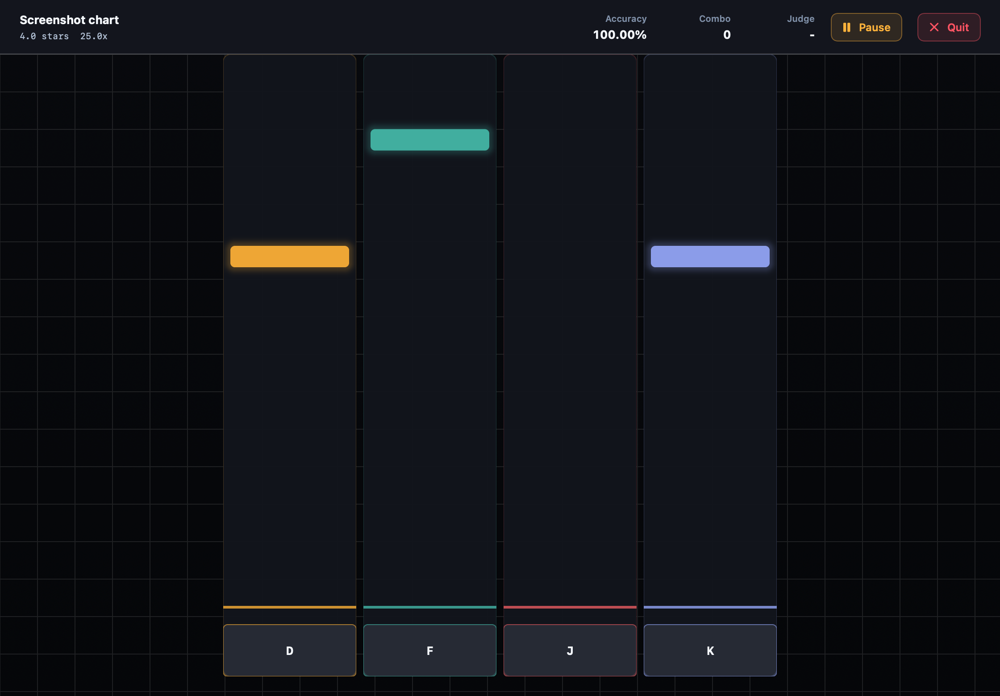
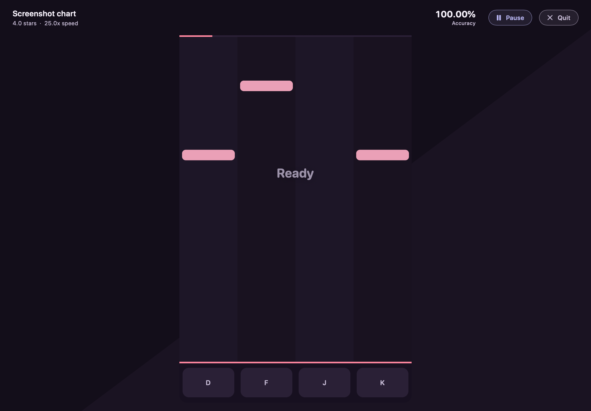
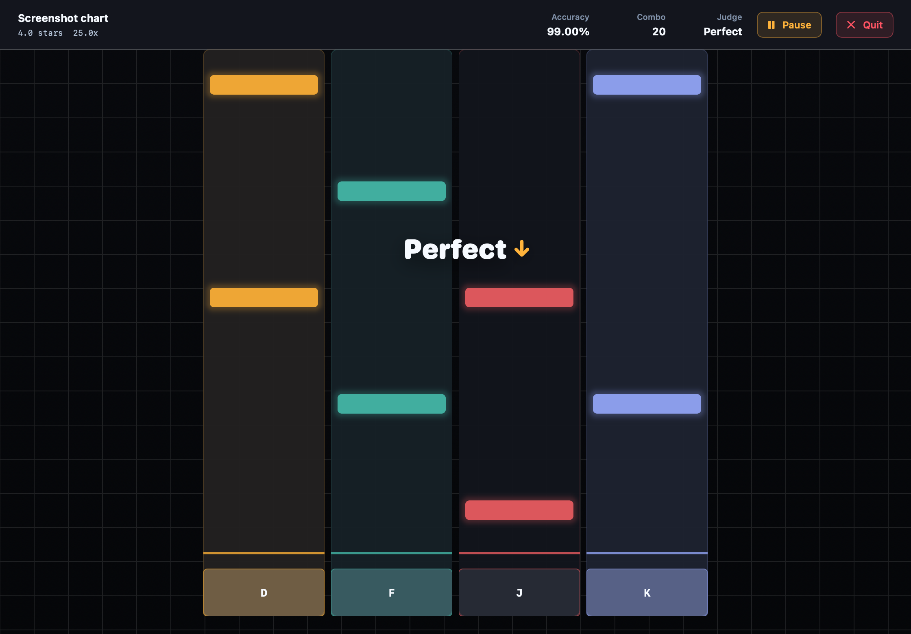
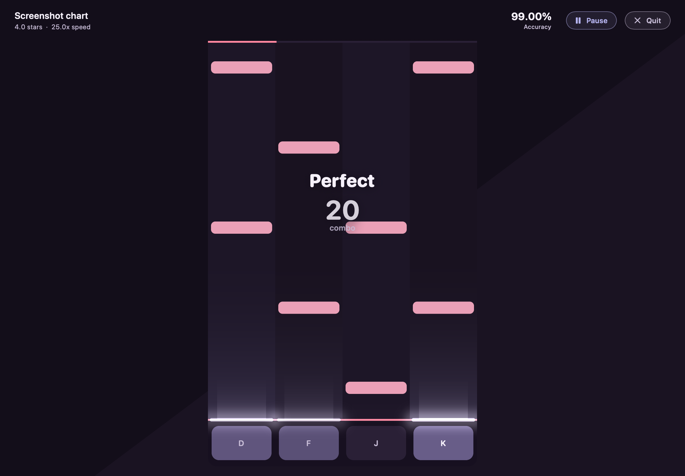
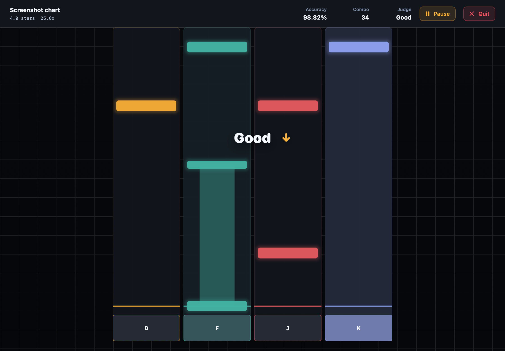
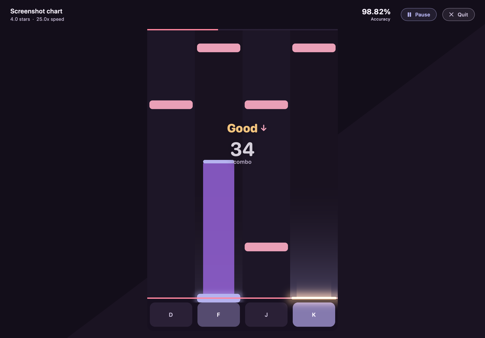
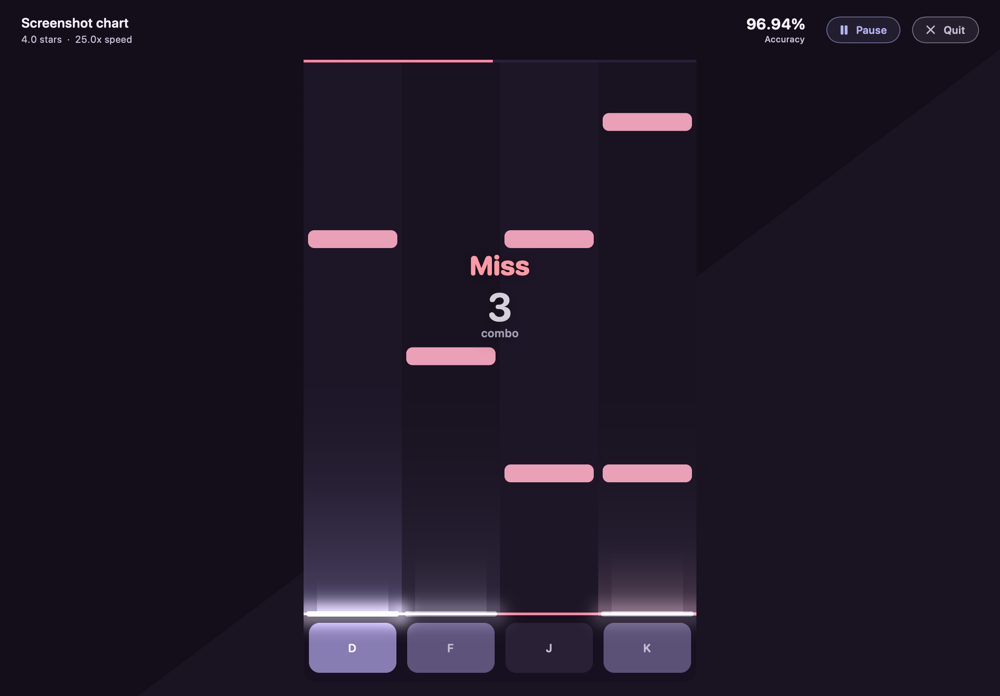
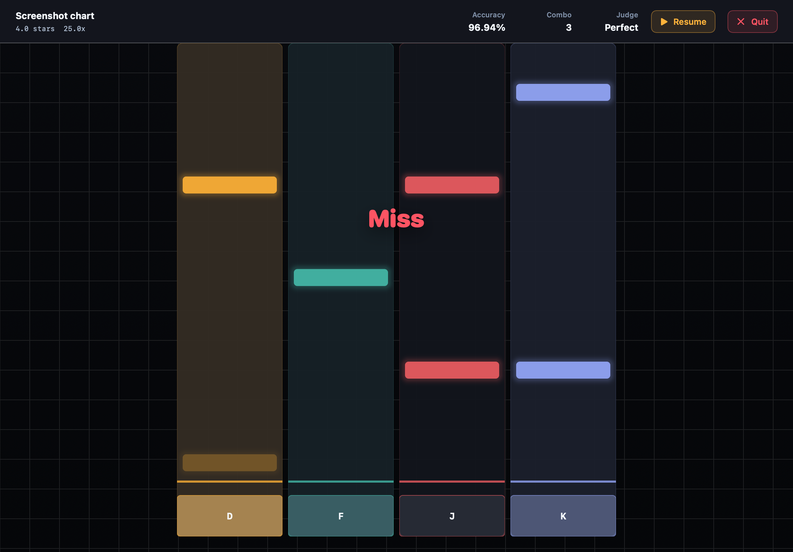
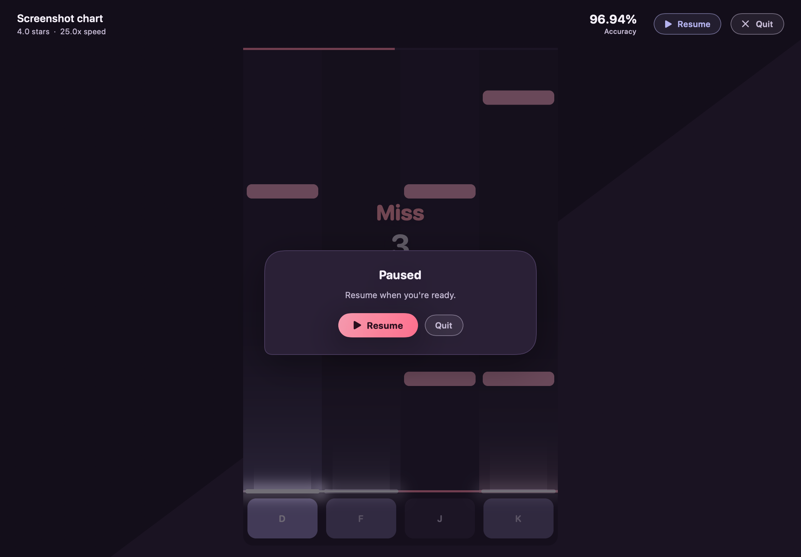
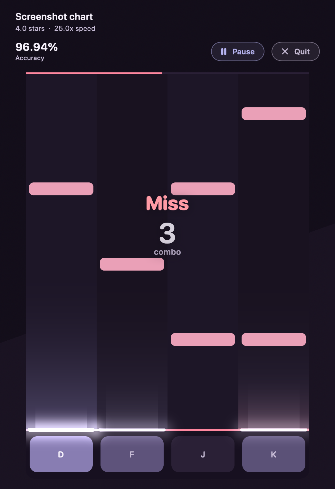

# Gameplay look

What the play screen shows and why it looks the way it does. The timing and
judgement contracts it draws from are in [architecture](architecture.md#gameplay-and-scoring);
the convention that other screens follow is in the [design guidelines](design-guidelines.md).

## Before and after

Rendered offscreen from the same chart and key presses (see
[Screenshots](#screenshots)); the play window's default size, 1120 by 780 points, at 2x.

| Moment | Before | After |
| --- | --- | --- |
| Before the first note |  |  |
| Chord passage, a three-note chord just hit |  |  |
| Hold in progress, a Good in another lane |  |  |
| Miss |  |  |
| Paused |  |  |
| Miss, 520 points wide | |  |

## Choices

- **One palette from the brand.** `Mania4KPlayPalette` holds the dark plum ground
  `#130E1A` with the brand's diagonal division (`#1A1322`) behind the stage, the web
  player's alternating lanes (`#1D1627`, `#191220`), rose taps (`#EAA0B7`), lavender
  hold heads and tails (`#B5B3EF`) and coral (`#FF879F`) for the judgement line and the
  song progress. The coral appears elsewhere only in the primary button. The per-lane
  amber, teal, red and blue and the grid backdrop are gone: notes are coloured by kind,
  as in the web player, and the brand rules out decorative grids.
- **Purple hold bodies.** Bodies use the mark's intersection purple (`#9562D7`) at 60 %,
  85 % while held. The web player's lavender at 42 % reads as a grey slab beside rose
  taps; purple keeps a hold distinct from a column of taps and repeats the icon's
  lavender-over-purple. A held head stays on the line and glows.
- **Plain, wide notes.** Lanes touch; notes are inset 5 points, 20 points tall with
  7-point corners and no glow. The old notes each had a 10-point glow, which smears a
  dense stream at high scroll speed. The playfield is at most 440 points wide (lanes of
  110 points; it was up to 620).
- **Notes land on the line.** A note centred on the line is drawn whole, then slips
  under the top edge of its key cap. A hit note disappears when the core reports it
  resolved (it stayed at 28 % before). A note judged a miss that is still on screen is
  greyed (`#8F7DAB` at 50 %), so a missed hold reads as dead.
- **Key tray.** Under the line, a tray with rounded bottom corners holds one key cap per
  lane (`#2A2036`, 12-point corners) labelled with the bound key. A press lights the cap
  and a lavender wash up the lane, both from the core's lane brightness; the label
  brightens while the key is down.
- **Hit feedback from the core's events.** Each recent judgement event (the feedback's
  event batches) lights the judgement line in its lane in the tier's colour, with a glow
  and a flare up the lane that grows and fades over 200 ms from the chart time the core
  recorded it. A miss tints the lane above the line and marks the line in the miss colour
  for 360 ms. A miss appears when the core decides it, after the note's last window and
  the input allowance, by when the note itself has usually left the screen.
- **Tier colours from the brand's status colours.** Perfect `#F6F1FB` (the text colour,
  the brightest), Good `#F3C47E`, Miss `#FF9AA5`. The tier is always named in words, so
  colour is not the only cue. A Good shows an arrow for early (lavender, up) or late
  (rose, down); a Perfect no longer does, which keeps the common case quiet.
- **Judgement and combo over the lanes.** The judgement word and the combo sit together
  at 42 % of the lane height; the core's presentation sets the word's opacity, scale and
  drift. The combo shows from 2. Until the first judgement of a play, "Ready" holds the
  place. The HUD row keeps the title, stars and speed, accuracy, Pause and Quit, on the
  ground without a panel; its Combo and Judge columns are gone, since the playfield shows
  both where the eyes already are.
- **Song progress.** A 3-point coral bar along the playfield's top edge: chart time over
  the chart's duration, drawn by Metal with each frame, so the SwiftUI HUD does not
  update per frame. A chart without a known duration has no bar.
- **Panels.** Loading, paused, stopped and results share one panel in the brand's card
  shape (26-point corners, 10 at the bottom left) on `#2A2036`. Paused dims the playfield
  and offers Resume, the primary pill in the coral gradient with dark ink, and Quit.
  The pause and quit buttons in the HUD are outlined pills.
- **Type.** SF Pro Rounded across the play screen, monospaced digits for accuracy and
  combo.

## Motion

Motion marks what acted: the line lights and the flare rises on a hit, the judgement word
pulses, and a miss drifts by the core's presentation. With Reduce Motion the flare is not
drawn, the line light only fades, and the judgement word takes the presentation's opacity
without its scale or drift.

## Frame cost

`GameplayTimingTests.testPlayfieldLayoutAndEncodeCost` (Debug, MacBook Air M5) lays out a
busy frame, about 70 notes with every lane lit and eight hits at the line (134 quads),
encodes it and times the GPU drawing it at 720 by 1400 pixels. Measured twice for each
look on the same machine minutes apart, while another job loaded it:

| | Layout, CPU p50 | Encode p50 | GPU p50 |
| --- | ---: | ---: | ---: |
| Before (130 quads, no hit feedback) | 0.21, 0.38 ms | 0.014, 0.028 ms | 0.93 ms |
| After (134 quads) | 0.25, 0.33 ms | 0.015, 0.030 ms | 0.52 ms |

The layout costs the same within the machine's load; the GPU time fell because the lanes
are filled once without strokes and notes have no glow.

## Screenshots

`PlayScreenScreenshotTests` plays a fixed chart (a lead-in, 16th-note chords at 150 BPM,
a hold under taps, a chord with one note never pressed) and a fixed input log through the
play model on a clock that stands still at each frame's time. It draws the playfield with
the app's Metal renderer into a texture and the rest with `ImageRenderer`, without a
window, a display or sound, and writes the PNGs to the directory given:

```sh
TEST_RUNNER_ENSOMI_SCREENSHOT_DIR="$PWD/docs/screenshots/gameplay-look/after" \
  xcodebuild -project Ensomi.xcodeproj -scheme EnsomiMac -destination 'platform=macOS' test \
  -only-testing:EnsomiCoreTests/PlayScreenScreenshotTests
```

The before set was rendered at `6ef7e3f`, the commit that added the test on top of
`gameplay/core`, so it has no narrow shot.

## Not checked

- The live app on a display: the screenshots are offscreen renders, so motion was seen
  only as stills, and the Metal view's colours were not compared with the render on
  screen.
- The loading, stopped and results panels were not rendered; they share the paused
  panel's view.
- iOS: it builds; the play screen was not inspected in a simulator.
- VoiceOver over the HUD and the panels.
- Accessibility text sizes: the HUD switches to its compact layout; the judgement word
  and combo keep fixed sizes, like the playfield.
