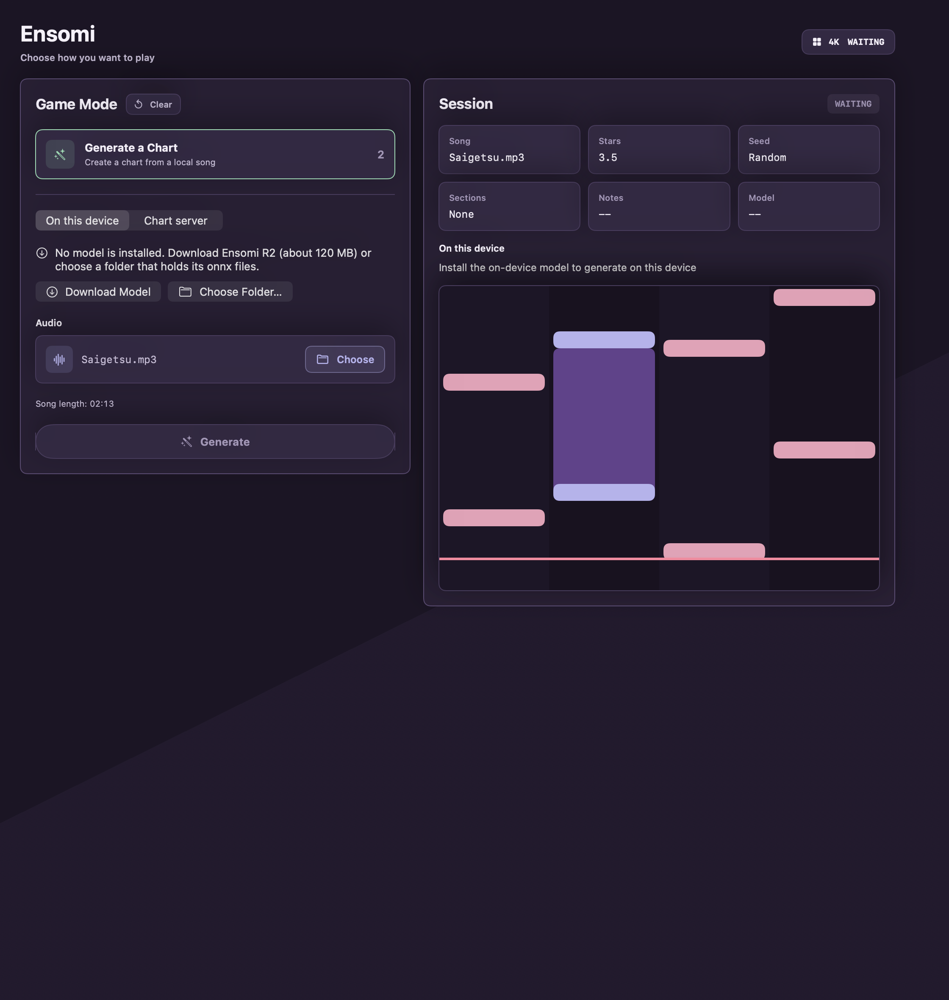
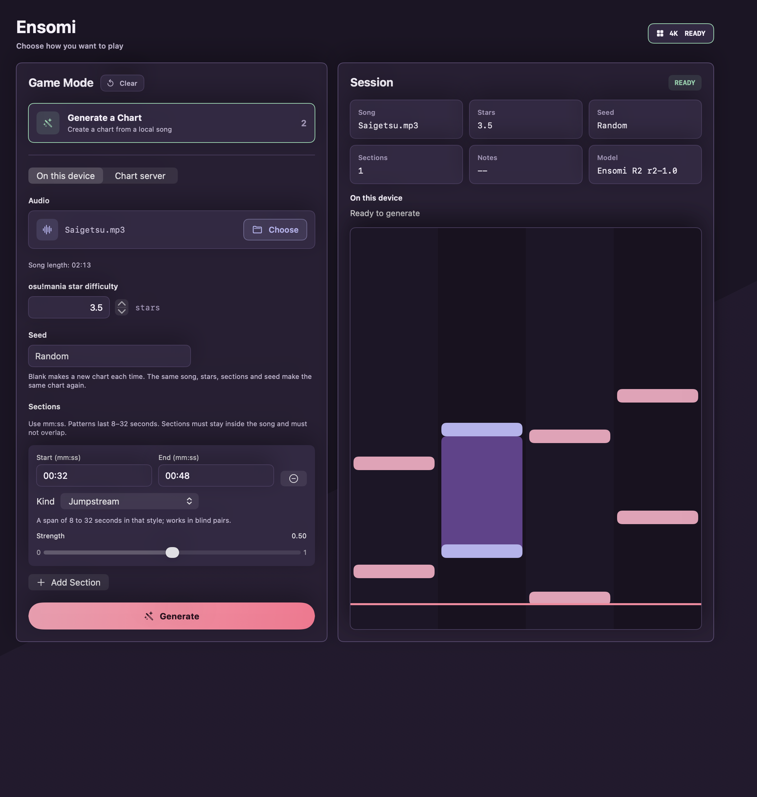
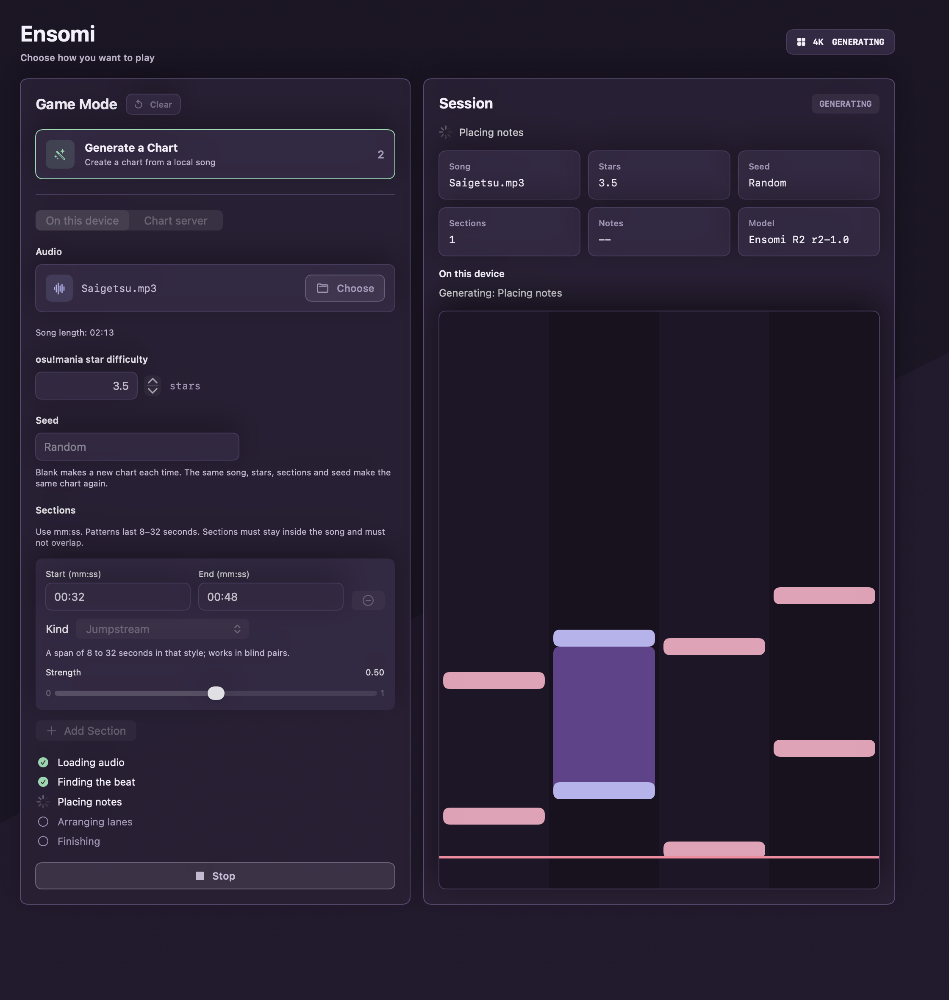
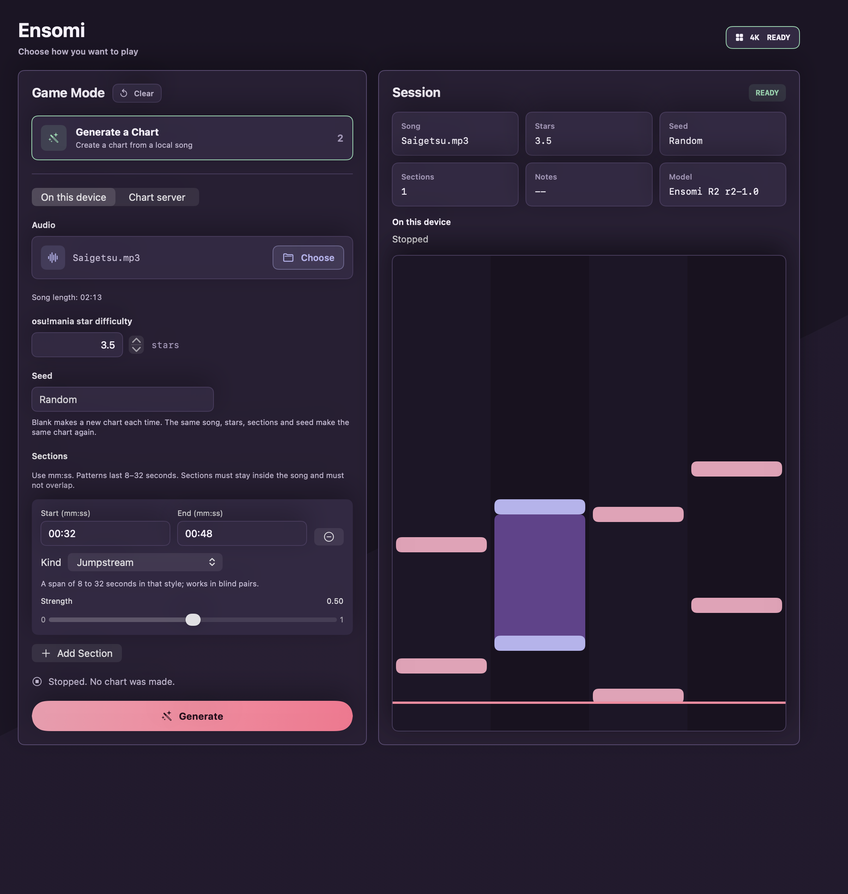
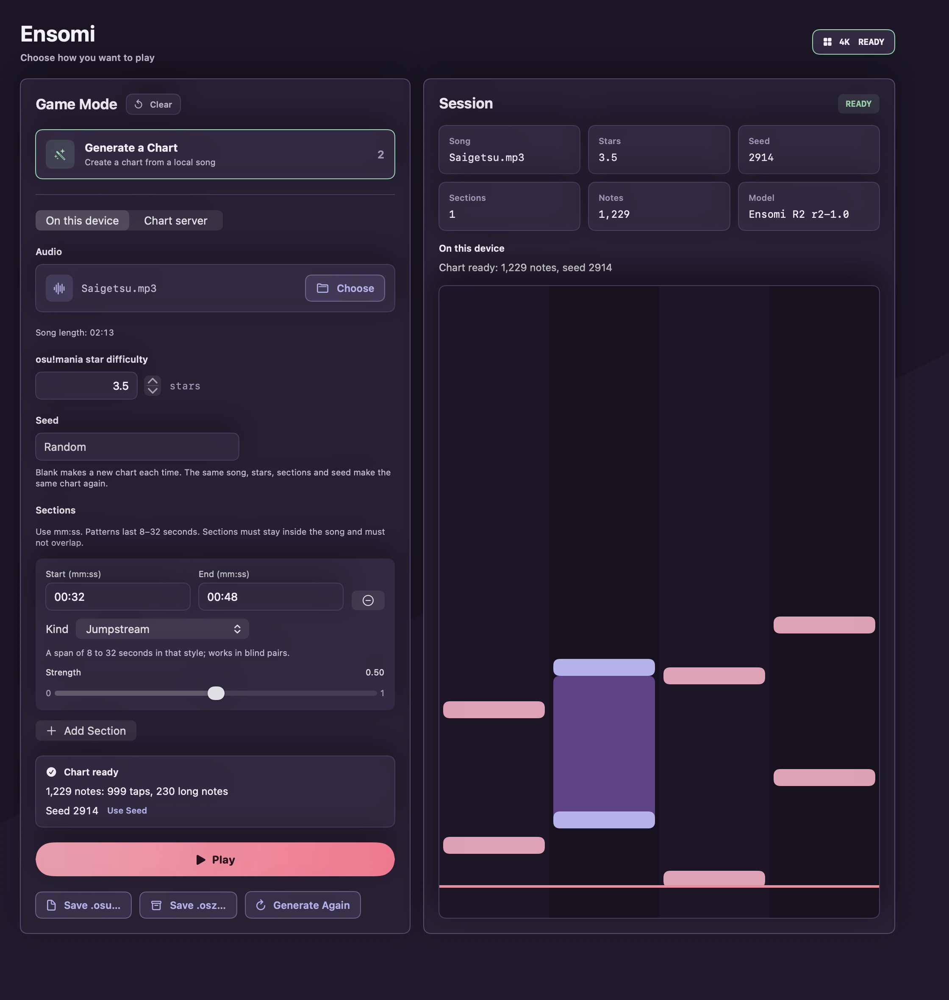
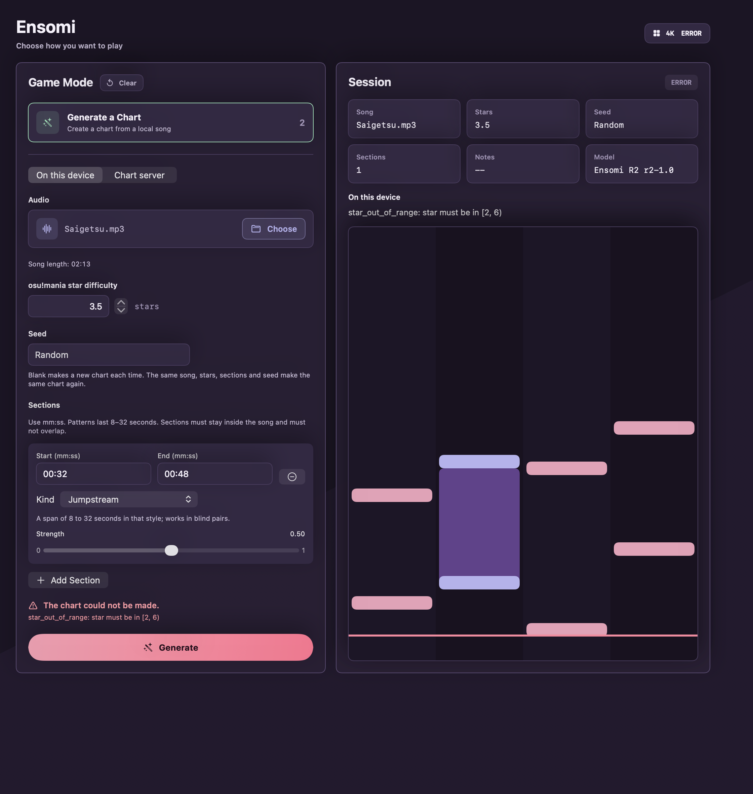

# Solo device mode

Generate a Chart can make the chart on the device that plays it. The app decodes the
song, the runtime's Rust core runs the Ensomi R2 generator with ONNX Runtime's CPU
provider inside the app process, and the chart plays through the same path as one from
the chart server. Nothing is sent to a server and no service has to run. The contract
is in [architecture](architecture.md#inference-transport-and-chart-streams); this
document is how the mode is installed, what runs where, what it costs and what it
does not do.

## Installing the model

The model is the published Ensomi R2 package, the `onnx/` directory of
[`sed-i/ensomi-r2`](https://huggingface.co/sed-i/ensomi-r2) on Hugging Face
(`runtime.json`, six graphs, state and array files: 29 files, 120 MB). Two ways to have it,
in Settings under Chart model, or on Generate a Chart when "On this device" is chosen
and no model is installed:

- **Download Model** fetches it into `Application Support/Ensomi/Models/ensomi-r2`
  with a progress bar and **Cancel Download**. It lists the directory
  (`/api/models/sed-i/ensomi-r2/tree/main/onnx`), downloads `runtime.json`, asks the
  runtime's `modelFiles(runtimeConfig:)` for the rest, adds `ensomi-model.json` if the
  listing has one (the runtime then checks the package against it on open), and checks
  every file's size and, where the listing gives an LFS object id, its SHA-256 (CryptoKit,
  in 1 MiB chunks). Files collect in `.download-ensomi-r2` beside the install directory.
  Only when every file is right and `ChartGenerator.open` accepts the directory is it moved
  into place, replacing an older install.
- **A stopped download resumes.** A failed or cancelled download leaves the installed model,
  if any, untouched and keeps `.download-ensomi-r2`: the files finished so far and the one in
  progress as `<name>.part`. The section then says the download stopped and offers **Resume
  Download**, which lists the directory again, checks each finished file's size and SHA-256
  against the new listing (fetching it again if it no longer matches), and asks for the rest
  of the partial file with `Range: bytes=<n>-`. A 206 answer is appended; a 200 answer (a
  server that ignores the range) rewrites the file from the start. When a resumed file then
  fails its size or SHA-256, as it does when the published file changed in between, it is
  fetched again whole. **Remove Download** also deletes the partial files. There is no
  automatic retry; resuming is the person's choice.
- **Choose Folder…** uses any directory that holds the files, such as a local copy of
  `onnx/`. The folder is refused unless `ChartGenerator` opens it. It is kept across
  launches as a bookmark (security-scoped on macOS, which also makes it work in a
  sandboxed build) and takes precedence over the download; **Use Downloaded Model**
  goes back. **Remove Download** deletes the downloaded copy.

`EnsomiMac` has no entitlements file, so it is not sandboxed: it reaches Hugging Face and
any folder without a grant. A sandboxed channel would need the network client and
user-selected read entitlements. iOS is always sandboxed; the bookmark covers the
chosen folder there.

When a model is installed, "On this device" is the default engine; "Chart server" stays
selectable and the choice is remembered. The engine picker is disabled during a generation.

## What runs where

| Step | Where |
| --- | --- |
| Pick the song, section validation, star range | App (`Mania4KChartGenerationModel`); the range and section kinds come from the model's capabilities (`ChartGenerator.capabilities()`, mapped to the protocol `ModelCapabilities`) |
| Decode | App: `AVAudioFile` at the file's own sample rate, channels averaged in Double, then Float (`OnDeviceAudioDecoder`) |
| Resample to 22050 Hz, beat tracking (BeatThis), rows, arrangement, `.osu` | The runtime's Rust core in the app process; ONNX Runtime CPU runs the graphs on a thread of its own |
| `.osz` | The runtime's Rust core (`exportOsz`, `crates/osz`) from the `.osu`, the song file's bytes and the receipt; the app reads the song and writes the file the save panel names |
| Validate and play | App: the gameplay core checks the chart, `Mania4KPlaySessionModel` plays it from the song's time 0 |
| Server | Not involved |

The core resamples any PCM not at 22050 Hz with the runtime's soxr tables. Those 27 files
(`resample-<rate>.json`, `.bin` and `-boundary.bin` for 11025, 16000, 24000, 32000, 44100, 48000,
88200, 96000 and 192000 Hz, 14 MB) are not in the runtime repository. The runtime's
`scripts/build-apple.sh` copies them from the TypeScript runtime's
`ensomi-web/packages/runtime/assets` into `../ensomi-runtime/build/apple/resampler`, and
`project.yml` bundles that directory into `EnsomiMac` and `EnsomiIOS` as a folder resource
(`resampler` in the bundle's resources). The app passes the bundled directory as
`resamplerDirectory`. A song at 22050 Hz needs none of them.

Generate lists the core's five phases (loading, timing, rows, arrangement, export) as they
pass. Stop cancels the task; the core stops at its next graph run or phase and the screen says
no chart was made. A refusal (`star_out_of_range`, `unsupported_control`, `generation_failed`) or
an unreadable model shows the core's message under "The chart could not be made." The generator
is opened once and kept.

## Seed and export

The Seed field takes a whole number from 0 to 2^64 − 1; blank gives a new chart each time
(on this device a random seed below 2^32, small enough to retype). A finished chart shows its
note count and the seed the engine used, from its receipt, with **Use Seed** to put it in the
field: the same song, model, stars, sections and seed make the same chart. Then come **Play**,
**Save .osu…**, **Save .osz…** and **Generate Again**. The chart and the chosen mode stay
after play ends, so a chart can be played and then saved.

The save panel proposes the web app's name, `Artist - Title (ensomi R2 s<seed>)`, with the song
file's name as the title. The `.osu` is the core's text. The `.osz` is a zip made by the Rust
core with the web runtime's layout: `generated.osu` (deflated), the song file as
`audio.<extension>` (stored), the name the `.osu`'s `AudioFilename` gives it, and
`receipt.json` (the receipt JSON and a newline, deflated). Entries carry the zip format's earliest
date, so the same chart and song give the same bytes. The chart server returns no `.osu`, so
its charts have no save buttons; when its receipt names an `.osz` it wrote on its own machine,
the screen shows that path.

## Time and memory

On bings-mac (Apple M5, macOS 27, Debug build of the app's test bundle, CPU provider), for a
133 s stereo MP3 at 44.1 kHz that gives a chart of 1225 objects at 3.5 stars, seed 0:

| Quantity | Result |
| --- | --- |
| Open the model (`ChartGenerator.open`) | 0.24 s |
| Decode the song alone | 1.47 s |
| Decode and generate | 7.30 s |
| Native command line generator on the same PCM (generation only) | 5.35 s |
| Start the play session | 0.62 s |
| Silent autoplay of the whole chart | 1225 perfect, 0 good, 0 miss |
| Peak physical footprint of the process | 1.99 GiB |

The footprint is `ri_lifetime_max_phys_footprint` from `proc_pid_rusage` at the end of the
run, in the XCTest process that opened the model, decoded, generated and played: the
runtime's own measurement for this model is 2.0 to 2.3 GiB peak, of which BeatThis's
working memory is most. The decoded song as mono Float is 23.5 MB. Core ML is not offered:
it opens in 10 s, runs BeatThis two to three times slower and needs 11.5 GiB (see the
runtime's Swift README). On iOS the core's `lowMemory` default is on (1.3 to 1.6 GiB on the Mac).

In the iOS simulator (iPhone 17, iOS 27 simulator on bings-mac, the runtime's `GeneratorTests`
through the Swift API on the recorded PCM of hesitation-snow), both generations gave the chart the
native generator made on macOS (`conformance/generate/native-charts`), byte for byte:

| Run | Low memory off | Low memory on |
| --- | --- | --- |
| iOS simulator | 11.1 s | 21.1 s |
| iOS simulator, a second run while other jobs loaded the Mac (load average 35 to 67) | 29.7 s | 32.2 s |
| macOS, `swift test`, same test, same load | 9.7 s | 13.6 s |

The simulator runs the arm64 simulator slice on the Mac's cores; it says nothing about a phone's
speed or memory limit.

Downloading the 29 files from Hugging Face to the Mac took 36 s and 64 s in two runs
(the link, not the app, sets that).

## Checks

All of these run on the Mac with `xcodebuild … test -only-testing:EnsomiCoreTests/<class>`;
each skips when its files are absent (`ENSOMI_R2_ONNX`, `ENSOMI_RESAMPLER`, `ENSOMI_SONG`
and `ENSOMI_GENERATE_CLI` override the sibling-checkout defaults).

- `OnDeviceChartGenerationTests`: decoder rate and channel averaging, the capability,
  phase and control mappings, the engine default and its persistence, a chosen folder
  kept only if the generator opens it.
- `ChartModelDownloaderTests`: install from a local copy of the listing and files
  (only the named files, opens, no leftovers), a wrong checksum (the bad file is not kept), a
  file the listing lacks, and, through an HTTP server inside the test process that serves the
  copy with Range support and can drop or stall a response: a connection lost 3 MB into
  `beatthis.onnx` (the next start sends `Range: bytes=3000000-` and fetches no finished file
  again; Remove Download leaves nothing), a file changed on the server while 5 MB of it waited
  (the resumed file fails its SHA-256 and is fetched again whole), and cancelling mid-file (the
  finished files and the partial one stay, the next start resumes).
  `TEST_RUNNER_ENSOMI_MODEL_DOWNLOAD_LIVE=1` also downloads from Hugging Face.
- `ChartGenerationClientTests`: the seed field (refuses what is not a seed, sends 2^64 − 1), the
  result keeping the seed the server reports though none was asked for, and Stop ending in the
  stopped state.
- `OnDeviceParityAndRunTests.testChartMatchesTheNativeGeneratorOnTheSamePCM`: the
  app's decoder and generator against `ensomi-runtime/target/apple/release/generate` on
  the same PCM dump, byte for byte. To keep the dump and both charts and compare by hand,
  from the app root on the Mac:

  ```sh
  TEST_RUNNER_ENSOMI_PARITY_OUT="$PWD/.build/parity" xcodebuild -project Ensomi.xcodeproj -scheme EnsomiMac \
    -destination 'platform=macOS' -derivedDataPath .build/solo test \
    -only-testing:EnsomiCoreTests/OnDeviceParityAndRunTests/testChartMatchesTheNativeGeneratorOnTheSamePCM
  ../ensomi-runtime/target/apple/release/generate --model-dir ../ensomi-model/artifacts/release-r2/bulk/hf/ensomi-r2/onnx \
    --assets ../ensomi-runtime/build/apple/resampler --pcm .build/parity/saigetsu.f32 --sample-rate 44100 \
    --star 3.5 --seed 0 --title Saigetsu --artist Parity --audio-name audio.mp3 --out .build/parity/by-hand.osu
  cmp .build/parity/app.osu .build/parity/by-hand.osu
  ```

  The PCM is 5,875,200 samples at 44,100 Hz; both charts are 34,867 bytes with the same
  SHA-256. Other decoders give other PCM and other charts, and were not compared.
- `OnDeviceParityAndRunTests.testGenerateOnThisDeviceThenExport`: generates saigetsu at 3.5
  stars with a random seed through the generation model, checks the `.osu` parses to the chart,
  writes the `.osz` and opens it with `/usr/bin/unzip`: `audio.mp3` (the song's bytes),
  `generated.osu` (the `.osu`) and `receipt.json` (with the seed). Nothing is played. One run:
  1152 objects with seed 1520549647 in 8.8 s, a 2,138,366-byte `.osz`.
- The runtime's checks for the exporter: `cargo test -p ensomi-osz` reads the archive back with
  the `zip` crate (names, order, stored and deflated entries, contents, same bytes twice), and
  `swift test` in `ensomi-runtime/swift` opens `exportOsz`'s archive with `/usr/bin/unzip`.
- `OnDeviceParityAndRunTests.testGenerateOnThisDeviceThenAutoplaySilently`
  (`TEST_RUNNER_ENSOMI_E2E_RUN=1`): the numbers above. It drives the generation model and
  the play session in process with the engine's output volume at 0, so nothing is heard
  and no window opens.

- `SetupScreenScreenshotTests` (`TEST_RUNNER_ENSOMI_SCREENSHOT_DIR`): renders Settings and
  Generate a Chart offscreen into PNGs, without a window that takes events. Settings: the Chart
  model section with no model, a download starting, a refused folder and a chosen folder.
  Generate a Chart (1120 by 1180 points, the play window's width, at 2x) on this device with
  saigetsu as `Saigetsu.mp3` and one jumpstream section: no model, ready, generating (set to the
  rows phase), stopped (set), finished (a real generation, seed 2914) and failed (the core's real
  refusal of 7 stars). The set in `docs/screenshots/solo-device` was rendered with:

  ```sh
  TEST_RUNNER_ENSOMI_SCREENSHOT_DIR="$PWD/docs/screenshots/solo-device" xcodebuild -project Ensomi.xcodeproj \
    -scheme EnsomiMac -destination 'platform=macOS' test -only-testing:EnsomiCoreTests/SetupScreenScreenshotTests
  ```

The review of the first renders found the setup screen in the placeholder navy, blue and
green with a grid and a lane preview in per-lane amber, teal, red and blue, against the play
screen's plum theme and notes coloured by kind; Session tiles for Mode, Beatmap ("Backend
generated"), Mock and Reference that mean nothing here; an unlabelled model line; a slider
labelled twice; and the raw core message as the only failure text. Each is changed as the
[design guidelines](design-guidelines.md) now describe. The save panel itself and the screen
at narrow widths and with large text were not rendered.

| State | Screen |
| --- | --- |
| No model |  |
| Ready |  |
| Generating |  |
| Stopped |  |
| Finished |  |
| Failed |  |

## Limits

- CPU only, on macOS and iOS. The footprint is about 2 GiB on the Mac.
- One generation at a time. Stop takes effect at the core's next graph run or phase.
- The whole song is decoded into memory before generation.
- Charts from the chart server cannot be saved from the app: the protocol's result carries no
  `.osu`.
- Long-note amount stays unspecified, as with the server.
- A download has no automatic retry. A file without an LFS object id (the JSON files) is checked
  by size only. Resuming against Hugging Face itself (its redirect to the file host keeping the
  Range header) was not tried; the tests use a local server.
- ONNX Runtime's MIT licence and notices (`ensomi-runtime/licenses/onnxruntime`) are not
  yet shown in the app.
- On iOS the app builds for the simulator and the generator runs there through the Swift API;
  the app's screens were not run on iOS and nothing ran on a device.
